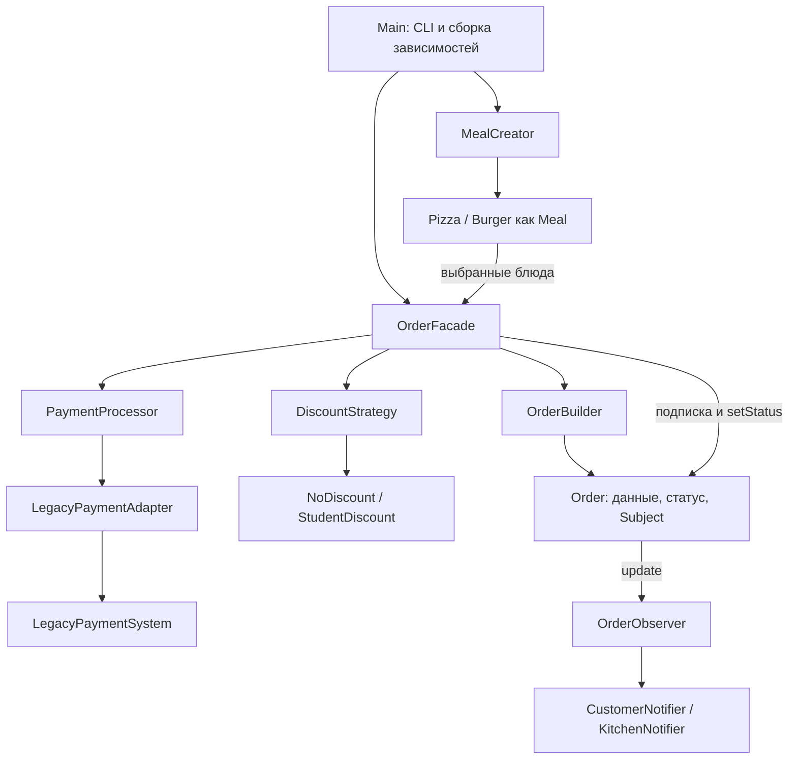
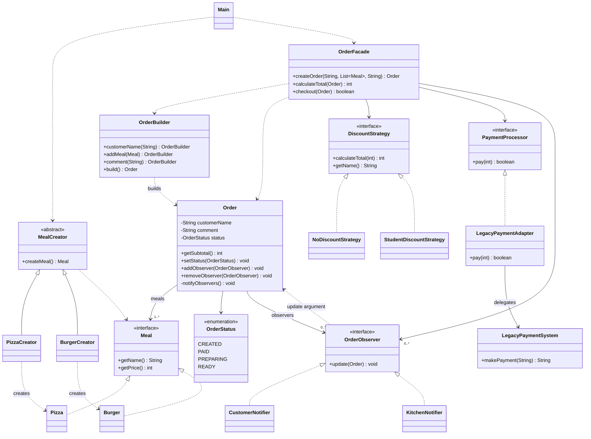
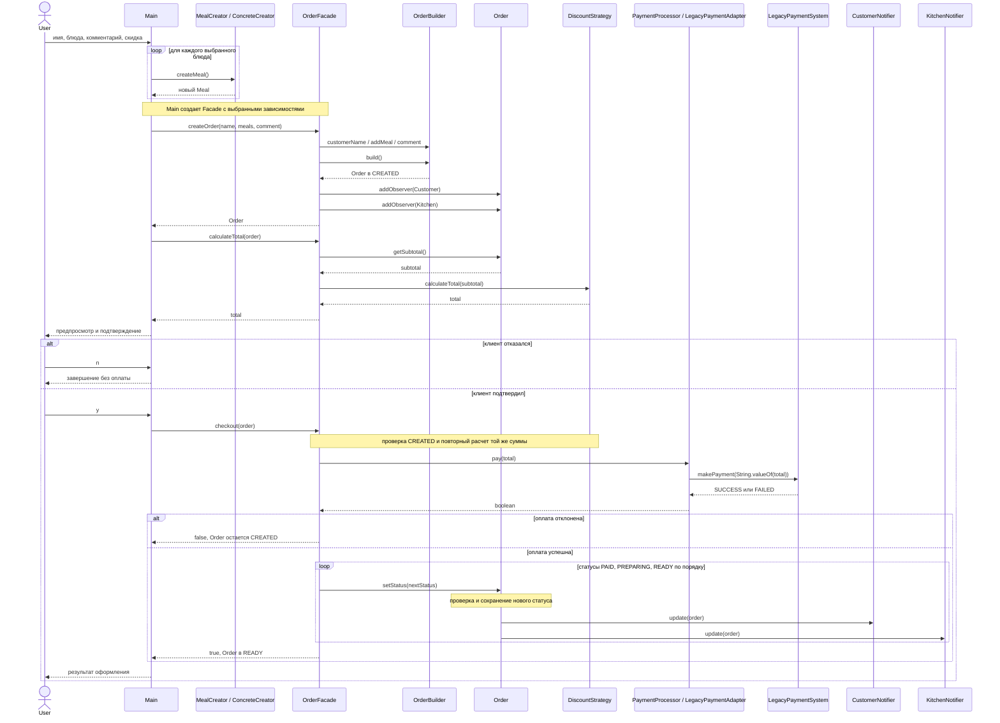

# Restaurant Ordering System

Техническое задание и руководство команды по разработке Final Project для **Software Design Patterns**. Приложение оформляет ресторанный заказ через консоль и демонстрирует шесть согласованно работающих Design Patterns.

Документ описывает **целевую реализацию**. Примеры вывода показывают ожидаемое поведение; выполненную работу отмечаем в checklists только после проверки настоящего приложения. Готовой реализации проекта в этом README нет.

**Текущий этап — часть Askhat реализована.** В `src/main/java/org/example/restaurant/` добавлены девять файлов: `Meal`, `Pizza`, `Burger`, три Creator, `Order`, `OrderBuilder` и `OrderStatus`. Работают создание блюд, пошаговая сборка и валидация заказа, защита списка, расчет subtotal и правила переходов статуса. [UML-фрагмент Askhat](docs/uml/askhat-factory-builder.md) описывает эти компоненты и их взаимодействие.

Проверено: компиляция с `javac --release 17 -Xlint:all -Werror` и ручные вызовы в JShell — цены `3000` / `2000`, subtotal `5000`, повторные позиции, нормализация полей, независимость заказов, неизменяемость списка, неправильные данные, переполнение суммы и переходы статусов. Использован установленный JDK 25 с целевой версией компиляции 17; запуск на отдельном JDK 17 пока не выполнялся. Автоматизированные тесты не добавлены.

Observer-часть `Order` (интерфейс, подписки и уведомления) остается Danila; `Main`, Facade, платежи и перевод Maven с Java 25 на 17 — Egor. До этих этапов CLI и сквозной сценарий всего приложения еще не готовы. Danila добавляет уведомление после присваивания статуса, сохранив существующие проверки и no-op.

## 1. Project Overview

### Идея и цель

Клиент вводит имя, выбирает блюда, добавляет комментарий и скидку, проверяет сумму и подтверждает заказ. Система имитирует оплату и последовательно переводит заказ в статусы `PAID`, `PREPARING`, `READY`. Покупатель и кухня автоматически получают сообщения в консоли.

Цель — небольшое работающее приложение, в котором каждый участник самостоятельно реализует два паттерна и может объяснить их устройство, применение и взаимодействие с остальной системой.

| Параметр | Решение команды |
|---|---|
| Название | Simple Restaurant Ordering System |
| Язык | Java 17 |
| Интерфейс | Console Application / CLI |
| Сборка | Maven, один модуль |
| Данные | Объекты в памяти, один заказ за запуск |
| Деньги | Целое количество KZT, тип `int` |
| Зависимости приложения | Только стандартная Java |
| Проверка | Ручные сценарии через консоль и просмотр кода |

### Участники

| Участник | Личные паттерны | Дополнительная ответственность |
|---|---|---|
| **Askhat** | Factory Method, Builder | Модель блюд, основа `Order`, правила корректности заказа |
| **Danila** | Strategy, Observer | Расчет скидок, подписчики, Observer-часть `Order` |
| **Egor** | Adapter, Facade | Имитация оплаты, `Main.java`, CLI, Maven и интеграция |

Приоритеты: требования преподавателя → корректность паттернов → простая архитектура → понятное распределение работы → объяснимость на защите.

## 2. Project Requirements

### 2.1. Требования преподавателя

Источник: [Final Project Defense Requirements.pdf](</home/askhat/Downloads/Final Project Defense Requirements.pdf>), слайд 1. Это источник требований к сдаче; приведенные далее API и архитектура являются решениями команды.

| Требование | Как выполняем |
|---|---|
| Командный проект; рекомендована группа из 2–3 студентов | Команда Askhat, Danila, Egor |
| Не менее шести различных паттернов из курса | Ровно шесть паттернов из раздела 5 |
| Каждый студент самостоятельно реализует минимум два паттерна | Закрепленное распределение сохраняется |
| Единое связанное приложение | Все паттерны входят в сценарий оформления заказа |
| Паттерны полностью реализованы и демонстрируемо работают | Показываем работающий сценарий и соответствующий код |
| Паттерны работают согласованно; одновременное взаимодействие всех не требуется | Factory Method создает блюда до вызова Facade; остальные участвуют в оформлении |
| Report включает Introduction, Body, Conclusion, Further Work, код, screenshots и UML | Структура и ответственность приведены в разделе 14 |
| Сдача в Moodle | PDF Report и ZIP с исходным кодом |
| Защита перед преподавателем | Общая демонстрация и объяснение личного вклада |

Темы и сочетания паттернов на следующих слайдах PDF приведены как примеры. Упомянутый там Decorator для ресторана не становится обязательным требованием нашего проекта.

### 2.2. Дополнительные требования команды

- Java 17, Maven, CLI и фиксированное меню из двух блюд.
- Конкретное применение SOLID без лишних интерфейсов и слоев.
- Единые контракты, небольшие Pull Requests и согласованные изменения `Order`.
- Ручная проверка с ожидаемыми результатами и реальными screenshots для отчета.
- Минимальная функциональность, достаточная для демонстрации всех шести паттернов.

**Автоматизированное тестирование в предоставленном PDF не указано. Команда решила не добавлять JUnit, Unit Tests и другие автоматизированные тесты.** Это решение команды, а не запрет преподавателя. Успешная сборка проверяет компиляцию, а поведение проверяется вручную.

### 2.3. Scope

| Входит | Не входит |
|---|---|
| Один заказ за запуск, несколько блюд и повторный выбор одинакового блюда | История заказов, изменение готового заказа, удаление позиций |
| Имя клиента, необязательный комментарий, две скидки | Регистрация, Authentication, проверка студенческого статуса |
| Имитация оплаты и четыре статуса | Real Payment Gateway, возвраты, доставка |
| Консольные уведомления покупателю и кухне | Email, SMS, фоновые задачи, Multithreading |
| Java, Maven, данные в памяти | Spring Boot, REST API, Database, Hibernate/JPA, GUI, Web Frameworks, Docker, Microservices |

Не добавляем дополнительные Design Patterns, пользовательские иерархии исключений и отдельные сервисы без необходимости. Enum статусов и последовательные вызовы методов не требуют State или Chain of Responsibility.

## 3. Application Features

### 3.1. Функции

| Функция | Ожидаемое поведение |
|---|---|
| Ввод имени | Непустое имя после `trim()` |
| Выбор блюд | `1` добавляет Pizza, `2` — Burger, `0` завершает выбор |
| Несколько позиций | Каждое добавление создает отдельный `Meal`; одинаковые блюда разрешены |
| Комментарий | Пустая строка допустима; комментарий не влияет на цену |
| Выбор скидки | `1` — No Discount, `2` — Student Discount |
| Предпросмотр | Имя, позиции, комментарий, начальный статус, subtotal, скидка и total |
| Подтверждение | `y` запускает оформление; `n` завершает программу без оплаты |
| Имитация оплаты | В платежную систему передается сумма после скидки |
| Статусы и уведомления | После успешной оплаты автоматически выполняются три перехода и уведомления |
| Ошибочный ввод | Понятное сообщение и повтор текущего ввода без потери выбранных блюд |

### 3.2. Меню и скидки

| Выбор | Блюдо | Цена |
|---|---|---:|
| `1` | Pizza | 3000 KZT |
| `2` | Burger | 2000 KZT |

| Выбор | Strategy | Отображаемое название | Итог для subtotal 5000 KZT |
|---|---|---|---:|
| `1` | `NoDiscountStrategy` | No Discount | 5000 KZT |
| `2` | `StudentDiscountStrategy` | Student Discount | 4500 KZT |

`subtotal` — сумма цен всех блюд. `total` — результат применения выбранной Strategy. Цена блюда не изменяется при применении скидки. Налоги, доставка и дополнительные платежи отсутствуют.

### 3.3. Статусы

```text
CREATED --успешная оплата--> PAID --> PREPARING --> READY
```

| Статус | Значение |
|---|---|
| `CREATED` | Builder создал корректный заказ; оплата еще не выполнена |
| `PAID` | `PaymentProcessor.pay(total)` вернул `true` |
| `PREPARING` | Имитируется приготовление |
| `READY` | Заказ готов, сценарий завершен |

Переходы выполняются синхронно и сразу, без потоков, задержек и `Thread.sleep()`. При отказе оплаты заказ остается `CREATED`. При отказе клиента объект просто больше не используется; отдельного статуса `CANCELLED` нет.

## 4. Application Workflow

### 4.1. Пользовательский сценарий

| Шаг | Пользователь / CLI | Взаимодействие компонентов |
|---:|---|---|
| 1 | Запускает программу | `Main` создает `Scanner` и выводит приветствие |
| 2 | Вводит имя | CLI повторяет ввод при пустом имени |
| 3 | Выбирает блюда, затем `0` | `Main` выбирает Concrete Creator и вызывает `createMeal()` через `MealCreator` |
| 4 | Вводит комментарий | Пустая строка означает отсутствие комментария |
| 5 | Выбирает скидку | `Main` выбирает `DiscountStrategy` и создает настроенный `OrderFacade` |
| 6 | Видит заказ и сумму | `createOrder(...)` использует Builder и подписывает двух observers; `calculateTotal(order)` применяет Strategy |
| 7 | Подтверждает `y` или отказывается `n` | При `n` программа завершается без `checkout()` |
| 8 | Ожидает результат | `checkout(order)` вызывает оплату через `PaymentProcessor` и Adapter |
| 9 | Видит уведомления | При успехе Facade вызывает `setStatus()` три раза; `Order` уведомляет observers |
| 10 | Получает финальный результат | `Main` сообщает об успехе либо отказе оплаты и завершает программу |

Пустой список блюд нельзя подтвердить: при `0` до добавления первой позиции CLI сообщает об ошибке и продолжает выбор.

### 4.2. Ожидаемый Console Output

Это образец будущего реального запуска, а не доказательство уже выполненной проверки. В отчете используем screenshots реализованного приложения.

```text
=== Simple Restaurant Ordering System ===
Имя клиента: Askhat

1. Pizza - 3000 KZT
2. Burger - 2000 KZT
0. Завершить выбор
Выбор: 1
Добавлено: Pizza - 3000 KZT
Выбор: 2
Добавлено: Burger - 2000 KZT
Выбор: 0
Комментарий (Enter - без комментария): Без лука

1. No Discount - 0%
2. Student Discount - 10%
Выбор скидки: 2

Клиент: Askhat
Блюда:
  Pizza - 3000 KZT
  Burger - 2000 KZT
Комментарий: Без лука
Статус: CREATED
Subtotal: 5000 KZT
Скидка: Student Discount
Total: 4500 KZT
Подтвердить заказ? (y/n): y

Имитация оплаты: 4500 KZT
[LegacyPaymentSystem] makePayment("4500") -> SUCCESS
[Customer: Askhat] Status: PAID
[Kitchen] Askhat: PAID
[Customer: Askhat] Status: PREPARING
[Kitchen] Askhat: PREPARING
[Customer: Askhat] Status: READY
[Kitchen] Askhat: READY
Заказ готов. Оплата успешна.
```

Сообщение `CREATED` выводит `Main` при предпросмотре. Создание заказа и подписка не являются изменением статуса и не вызывают Observer-уведомлений. Успешный сценарий дает **три уведомления каждому подписчику, шесть сообщений суммарно**.

## 5. Design Patterns Overview

| Pattern | Категория GoF | Назначение | Ответственный |
|---|---|---|---|
| Factory Method | Creational | Создание `Pizza` и `Burger` через наследников `MealCreator` | Askhat |
| Builder | Creational | Пошаговое создание корректного `Order` | Askhat |
| Strategy | Behavioral | Взаимозаменяемый расчет total | Danila |
| Observer | Behavioral | Автоматические уведомления при изменении статуса | Danila |
| Adapter | Structural | Совмещение `pay(int): boolean` и `makePayment(String): String` | Egor |
| Facade | Structural | Простой интерфейс к оформлению заказа и координация подсистем | Egor |

Рабочая цепочка: **Factory Method → список Meal → Facade → Builder → Strategy → Adapter → изменения Order → Observer**. Предпросмотр и подтверждение разделены; до подтверждения платеж не вызывается.

## 6. Detailed Responsibilities

### 6.1. Askhat — Factory Method

**Purpose.** Создавать конкретные блюда через общий Creator. Клиентский код работает с `Meal`, а конкретный тип результата определяется Concrete Creator.

Для двух блюд такой механизм больше, чем требуется обычной программе, но здесь он демонстрирует назначенный паттерн. Добавление нового блюда должно требовать нового Product и Concrete Creator, без изменения существующих creators и кода оформления заказа.

| Компонент | Роль | Обязательные сигнатуры / поведение |
|---|---|---|
| `Meal` | Product interface | `String getName()`, `int getPrice()` |
| `Pizza` | Concrete Product | Реализует `Meal`, возвращает `"Pizza"` и `3000` |
| `Burger` | Concrete Product | Реализует `Meal`, возвращает `"Burger"` и `2000` |
| `MealCreator` | Abstract Creator | `public abstract Meal createMeal()` |
| `PizzaCreator` | Concrete Creator | `public Meal createMeal()` возвращает новый `Pizza` |
| `BurgerCreator` | Concrete Creator | `public Meal createMeal()` возвращает новый `Burger` |

Concrete Products не имеют изменяемой цены или setters. Concrete Creators имеют доступные конструкторы без параметров. `MealCreator` является `abstract class`, а не классом с `switch` внутри фабричного метода.

**Работа и связи.** `Main` связывает выбор меню с `PizzaCreator` или `BurgerCreator`, затем вызывает единый `createMeal()`. Полученный объект добавляется в список и позже передается в Facade. Прямые `new Pizza()` и `new Burger()` находятся только внутри соответствующих creators.

```java
MealCreator creator = new PizzaCreator();
Meal meal = creator.createMeal();
selectedMeals.add(meal);
```

`selectedMeals` здесь — существующий `List<Meal>` в `Main`. Переключение пункта меню допустимо в CLI: оно выбирает Creator. Это не заменяет полиморфный Factory Method.

**Definition of Done — Factory Method**

- [x] Реализованы Product, Creator и оба Concrete Creator.
- [x] Каждый вызов creator создает новый объект с правильными именем и ценой.
- [ ] CLI создает обе разновидности блюд через `MealCreator`.
- [x] Внутри `MealCreator` отсутствует выбор типа через `switch` или `if`.
- [x] Подготовлен UML-фрагмент Askhat; полиморфный вызов через `MealCreator` проверен вручную в JShell.

**На Defense:** назвать все роли, показать переопределение `createMeal()`, объяснить отличие от Simple Factory и показать путь блюда из creator в заказ.

### 6.2. Askhat — Builder

**Purpose.** Отделить накопление параметров и проверку заказа от готового `Order`. Метод chaining позволяет собрать объект постепенно, включая повторяющиеся блюда и необязательный комментарий.

| Компонент | Роль | Ответственность |
|---|---|---|
| `Order` | Product | Хранит корректные данные, вычисляет subtotal, управляет своим статусом и подписками |
| `OrderBuilder` | Builder / Concrete Builder для одного вида Product | Накопление параметров, валидация, создание независимого `Order` |
| `OrderStatus` | Enum состояния Product | `CREATED`, `PAID`, `PREPARING`, `READY` |
| `OrderFacade.createOrder(...)` | Клиент Builder; выполняет роль Director в сценарии | Вызывает шаги сборки в нужном порядке |

Отдельные `Director` и `Builder` interface для единственной разновидности заказа не нужны. Используем простой fluent Builder: шаги построения отделены от Product, а Facade управляет их выполнением.

**API Builder:**

```java
public OrderBuilder();
public OrderBuilder customerName(String customerName);
public OrderBuilder addMeal(Meal meal);
public OrderBuilder comment(String comment);
public Order build();
```

Это перечень сигнатур для реализации, а не готовый компилируемый класс. Такие блоки контрактов далее читаются аналогично.

**Данные и доступ к Order:**

| Поле | Тип | Правило |
|---|---|---|
| `customerName` | `String`, `final` | Непустое нормализованное имя |
| `meals` | `List<Meal>`, `final` | Непустая защитная копия; извне не изменяется |
| `comment` | `String`, `final` | По умолчанию `""`; `null` нормализуется в `""` |
| `status` | `OrderStatus` | Начальное значение всегда `CREATED`; меняется через `setStatus()` |
| `observers` | Закрытая коллекция `OrderObserver` | Служебное состояние Subject; начинается пустой |

У `Order` есть package-private конструктор `Order(String customerName, List<Meal> meals, String comment)`. `OrderBuilder` находится в том же package. Внешний код создает заказы через Builder или Facade. Setters для имени, блюд и комментария отсутствуют.

**Правила сборки:**

- `customerName(...)` сразу отклоняет `null`, пустое имя и пробелы; допустимое имя сохраняется после `trim()`. Если этот шаг пропущен, отсутствие имени обнаруживает `build()`.
- В заказе минимум одно блюдо; `addMeal(null)` недопустим. Повторение блюда разрешено.
- Комментарий нормализуется: `null` → `""`, остальные значения → `trim()`.
- `build()` проверяет обязательные данные и допустимость суммы в `int`; при ошибке бросает `IllegalArgumentException` и не создает заказ.
- Построенный заказ получает независимую неизменяемую копию списка, например через `List.copyOf(...)`; дальнейшее изменение Builder не изменяет прежний заказ.

Проверку переполнения subtotal достаточно выполнить при сборке с промежуточной суммой `long`; сумма должна быть не больше `Integer.MAX_VALUE`. Отдельный денежный класс не требуется.

```java
Order order = new OrderBuilder()
        .customerName("Askhat")
        .addMeal(new PizzaCreator().createMeal())
        .addMeal(new BurgerCreator().createMeal())
        .comment("Без лука")
        .build();
```

В основном приложении эту последовательность выполняет Facade. Пример отдельно демонстрирует API Builder. Начальный subtotal — `5000`, статус — `CREATED`; скидка, оплата и подписчики не являются параметрами Builder.

**Definition of Done — Builder**

- [x] Chaining работает; комментарий можно не задавать.
- [x] Нельзя построить заказ без имени или блюд; неправильные ссылки отклоняются.
- [x] Список блюд защищен от изменения, два вызова `build()` не разделяют изменяемое состояние заказа.
- [x] Заказ создается в `CREATED`; Builder не принимает произвольный статус.
- [ ] Основа `Order` согласована с Danila; сценарий Facade использует настоящий Builder.

**На Defense:** показать этапы сборки, обязательные и необязательные данные, место валидации и отделение Builder от готового Product. Объяснить, почему для одного Product не введен отдельный Director-класс.

### 6.3. Danila — Strategy

**Purpose.** Менять алгоритм определения total без изменения оформления, оплаты и `Order`. `OrderFacade` выступает Context и получает Strategy через конструктор.

| Компонент | Роль | API / результат |
|---|---|---|
| `DiscountStrategy` | Strategy interface | `int calculateTotal(int subtotal)`, `String getName()` |
| `NoDiscountStrategy` | Concrete Strategy | Возвращает исходный subtotal; имя `"No Discount"` |
| `StudentDiscountStrategy` | Concrete Strategy | Возвращает 90% subtotal; имя `"Student Discount"` |
| `OrderFacade` | Context | Хранит `DiscountStrategy`, делегирует ей расчет |
| `Main` | Клиент | Выбирает реализацию по вводу пользователя |

**Контракт алгоритма.** Для `subtotal >= 0` результат находится в пределах `0..subtotal`. Для отрицательной суммы обе реализации бросают `IllegalArgumentException`. Расчет детерминирован: одинаковые данные дают одинаковый total, без изменения заказа и без побочных эффектов.

Student Discount округляет **итог после скидки вниз до целого KZT**. Безопасная арифметика: `(int) ((long) subtotal * 90 / 100)`. Для текущего меню дробных результатов не возникает. Не использовать `double` и не менять цены внутри `Meal`.

```java
DiscountStrategy strategy = new StudentDiscountStrategy();
int total = strategy.calculateTotal(5000); // 4500
```

`getName()` используется при показе выбранной скидки; CLI не определяет название через `instanceof`. В Facade нет формулы `* 90 / 100`, проверки конкретного класса или ветвления по типу скидки.

**Интеграция.** `Main` выбирает Strategy после выбора блюд и передает ее в Facade. Для одного заказа Strategy остается неизменной. Следующий запуск может выбрать другую реализацию; изменять Context не требуется. Дополнительный `DiscountService` или обязательный `setStrategy()` не нужны.

**Definition of Done — Strategy**

- [ ] Реализованы один интерфейс и две взаимозаменяемые реализации.
- [ ] Для `5000` результаты равны `5000` и `4500`; для `0` обе возвращают `0`.
- [ ] Контракт отрицательного значения и округления одинаково понимается всеми участниками.
- [ ] Facade вызывает интерфейс; формулы находятся только в Concrete Strategies.
- [ ] CLI действительно предлагает оба алгоритма; Danila подготовил UML-фрагмент и объяснение Context.

**На Defense:** показать замену алгоритма через интерфейс, место его выбора и место вызова. Объяснить, почему `if` выбора в CLI допустим, а вычисление скидки внутри `Main` разрушает выбранное разделение ответственности.

### 6.4. Danila — Observer

**Purpose.** Автоматически уведомлять независимых получателей при изменении статуса заказа. `Order` знает только интерфейс подписчика и не знает конкретных способов вывода сообщений.

| Компонент | Роль | Основной API |
|---|---|---|
| `Order` | Subject / Concrete Subject | `addObserver`, `removeObserver`, `setStatus`, закрытый `notifyObservers` |
| `OrderObserver` | Observer interface | `void update(Order order)` |
| `CustomerNotifier` | Concrete Observer | `public void update(Order order)` выводит имя и новый статус |
| `KitchenNotifier` | Concrete Observer | `public void update(Order order)` выводит сообщение кухне |
| `OrderFacade` | Настройка подписок и запуск сценария | Подписывает переданные observers и меняет статус после оплаты |

`OrderObserver` располагается в package `order`: это контракт модели заказа. Concrete Observers находятся в `notification`. Поэтому `Order` не зависит от конкретных notifiers, а между этими packages не возникает взаимной зависимости.

**API Subject:**

```java
public void addObserver(OrderObserver observer);
public void removeObserver(OrderObserver observer);
public void setStatus(OrderStatus newStatus);
private void notifyObservers();
```

**Правила уведомлений:**

- Повторная подписка того же экземпляра не создает дубликат; удаление отсутствующего подписчика ничего не меняет. `null` в обоих методах отклоняется через `IllegalArgumentException`.
- Подписка не отправляет текущее состояние. `CREATED` при построении также не порождает событие.
- `setStatus()` сначала проверяет переход, затем сохраняет новый статус и вызывает закрытый `notifyObservers()`; подписчики видят уже новое состояние.
- Установка того же статуса — no-op без повторного события. Пропуск этапа или обратный переход бросает `IllegalStateException` без изменения состояния и уведомлений.
- Concrete Observers только читают данные и выводят сообщение. В callback они не меняют статус или подписки; дополнительная обработка сбоев сторонних подписчиков в scope не входит.

Все зарегистрированные подписчики уведомляются синхронно в порядке добавления. В обычном приложении оба получают `PAID`, `PREPARING`, `READY`. `notifyObservers()` закрытый: `Main` и Facade не должны вызывать уведомления вручную.

```java
OrderObserver customer = new CustomerNotifier();
OrderObserver kitchen = new KitchenNotifier();
order.addObserver(customer);
order.addObserver(kitchen);
order.removeObserver(kitchen);
order.setStatus(OrderStatus.PAID);
```

В этом отдельном примере для уже созданного заказа `CREATED` сообщение получит только customer. Это демонстрация механизма Subject; в основном сценарии переход в `PAID` разрешает Facade после оплаты.

**Согласование с Askhat.** Danila самостоятельно реализует интерфейс, оба notifiers и Observer-часть `Order`: коллекцию, подписку, отписку и отправку уведомлений из `setStatus()`. Askhat сохраняет ответственность за данные, конструирование и инварианты заказа. Работу над общим файлом выполняем последовательно по правилам раздела 10.

**Definition of Done — Observer**

- [ ] Оба Concrete Observer реализуют один интерфейс и читают переданный `Order`.
- [ ] Подписка и отписка реально меняют получателей; один экземпляр не уведомляется дважды.
- [ ] Уведомления автоматически вызываются из `setStatus()` после сохранения нового состояния.
- [ ] Начальное состояние, no-op и неправильный переход не создают лишних уведомлений.
- [ ] В обычном сценарии получаем шесть сообщений; Danila может показать свой вклад в общий `Order`.

**На Defense:** показать Subject, Observer и подписчиков; объяснить направление зависимостей, автоматический характер уведомлений и результат отписки. Прямые вызовы двух notifiers из Facade не считаются реализацией Observer.

### 6.5. Egor — Adapter

**Purpose.** Подключить условную старую платежную систему к интерфейсу приложения. Несовместимость реальная: отличаются и тип аргумента, и тип результата.

| Компонент | Роль | Основной API |
|---|---|---|
| `PaymentProcessor` | Target interface | `boolean pay(int amount)` |
| `LegacyPaymentSystem` | Adaptee | `public String makePayment(String amount)` |
| `LegacyPaymentAdapter` | Object Adapter | `public LegacyPaymentAdapter(LegacyPaymentSystem legacyPaymentSystem)`, `public boolean pay(int amount)` |
| `OrderFacade` | Client | Вызывает только `PaymentProcessor.pay(...)` |

`LegacyPaymentSystem` — локальная имитация, написанная Egor. Ее строковый API рассматривается как заданный: нельзя заменить его на `pay(int)` ради устранения Adapter.

| Вход Legacy | Результат Legacy | Результат Adapter |
|---|---|---|
| Строка с положительным целым `int`, например `"4500"` | `"SUCCESS"` | `true` |
| `"0"`, отрицательное число, нечисловая строка, `null` или число вне `int` | `"FAILED"` | `false`, если вызов идет через Adapter |

У `pay(int)` нет строкового входа: через него проверяем положительное значение, `0` и отрицательное число. Некорректные строки проверяем непосредственно через `makePayment(String)`.

**Преобразование:** `int` → `String.valueOf(amount)` → `legacyPaymentSystem.makePayment(...)` → сравнение через `"SUCCESS".equals(result)` → `boolean`. Не сравнивать строки через `==` и не добавлять к сумме текст `KZT` перед передачей Legacy.

```java
PaymentProcessor payment =
        new LegacyPaymentAdapter(new LegacyPaymentSystem());
boolean paid = payment.pay(4500);
```

Adapter делегирует вызов даже для `0` и отрицательного значения: Legacy возвращает `FAILED`, Adapter — `false`. Диагностическая строка Legacy вида `makePayment("4500") -> SUCCESS` помогает показать преобразование на защите. Никаких ключей, запросов в сеть и реальных списаний нет.

В обычном CLI положительный total успешно оплачивается. Отказ при корректном заказе проверяется вручную подстановкой `PaymentProcessor`, возвращающего `false`, как показано в разделе 12. Отдельный режим CLI для ошибок не нужен.

**Definition of Done — Adapter**

- [ ] Target и Adaptee имеют согласованные несовместимые сигнатуры.
- [ ] Adapter содержит ссылку на Legacy и действительно вызывает ее метод.
- [ ] Сумма `4500` передается строкой `"4500"`; `SUCCESS` / `FAILED` преобразуются в `true` / `false`.
- [ ] Facade зависит только от `PaymentProcessor` и не анализирует Legacy-строки.
- [ ] Успех и отказ вручную проверены; Egor подготовил UML-фрагмент и объяснение преобразований.

**На Defense:** назвать Target, Adapter, Adaptee и Client; показать оба преобразования и объяснить, почему простой класс с методом оплаты без делегирования не демонстрирует Adapter.

### 6.6. Egor — Facade и интеграция

**Purpose.** Предоставить CLI короткий API к сборке и обработке заказа. Facade управляет последовательностью, делегируя предметную работу остальным компонентам.

```java
public OrderFacade(
        PaymentProcessor paymentProcessor,
        DiscountStrategy discountStrategy,
        List<OrderObserver> observers);

public Order createOrder(
        String customerName,
        List<Meal> meals,
        String comment);

public int calculateTotal(Order order);
public boolean checkout(Order order);
```

**Распределение операций:**

| Метод | Выполняет | Делегирует |
|---|---|---|
| Конструктор | Сохраняет ненулевые зависимости и защитную копию observers | Не создает конкретную Strategy или платежную систему |
| `createOrder(...)` | Вызывает шаги Builder, получает Order, подписывает observers | Валидацию и конструирование — Builder; подписку — Order |
| `calculateTotal(order)` | Передает `order.getSubtotal()` выбранной Strategy | Формулу — `DiscountStrategy` |
| `checkout(order)` | Проверяет начальный статус, рассчитывает total, вызывает оплату; при успехе запускает три перехода | Расчет — Strategy; оплату — PaymentProcessor; переходы и уведомления — Order |

`createOrder()` не списывает деньги. `calculateTotal()` не меняет состояние. `checkout()` возвращает `false` при отказе платежа и немедленно прекращает сценарий. Только после `true` от платежного компонента выполняется `CREATED → PAID → PREPARING → READY`, затем возвращается `true`.

**Согласованность суммы.** Предпросмотр и `checkout()` вызывают один и тот же `calculateTotal()`. В Facade хранится одна неизменная ссылка на Strategy, данные заказа и цены блюд неизменяемы, алгоритмы детерминированы. Поэтому повторный расчет дает ту же сумму. Дополнительные Quote / Receipt DTO и хранение total в `Order` не требуются.

```java
DiscountStrategy discount = new StudentDiscountStrategy();
PaymentProcessor payment =
        new LegacyPaymentAdapter(new LegacyPaymentSystem());
OrderFacade facade = new OrderFacade(
        payment, discount,
        List.of(new CustomerNotifier(), new KitchenNotifier()));

Order order = facade.createOrder("Askhat", selectedMeals, "Без лука");
int total = facade.calculateTotal(order);
```

После вывода `total` и получения подтверждения `Main` вызывает `facade.checkout(order)`. `selectedMeals` ранее заполнен через Factory Method. Пример показывает только использование API.

**Main.java отвечает за:**

- Чтение строк через один `Scanner`, меню, повтор ввода, предпросмотр и финальное сообщение.
- Выбор Concrete Creators и Concrete Strategy по пользовательскому вводу.
- Создание Legacy, Adapter, notifiers и Facade — это composition root приложения.
- Вызов `createOrder()`, `calculateTotal()` и, только после подтверждения, `checkout()`.
- Корректное завершение при отказе клиента, отказе оплаты или конце ввода.

CLI не содержит формул скидок, прямого вызова Legacy, ручных `update()` и последовательности изменения статусов. Facade не читает `Scanner` и не спрашивает подтверждение. Консольные сообщения подсистем ограничиваются notifiers и диагностикой имитации Legacy; общий диалог ведет `Main`.

**Definition of Done — Facade / Main**

- [ ] CLI поддерживает весь сценарий, обе позиции меню и обе скидки.
- [ ] Facade использует Builder, Strategy, PaymentProcessor и механизм Subject.
- [ ] До подтверждения платеж не вызывается; при отказе статус не меняется.
- [ ] Повторный checkout уже обработанного заказа отклоняется до повторной оплаты.
- [ ] Egor настроил Java 17, выполнил интеграцию и собрал реальные screenshots; участники проверили свои компоненты в общем сценарии.

**На Defense:** показать, какую последовательность скрывает Facade, где остаются бизнес-правила и почему клиенту не требуется знать устройство платежной подсистемы и уведомлений. Объяснить constructor injection и границу CLI.

## 7. Project Architecture

### 7.1. Целевая структура

Базовый package: `org.example.restaurant`. Регистр имен файлов должен совпадать с именами public-классов. Структура ниже — план разработки, а не перечень уже реализованных файлов.

```text
Restaurant-Ordering-System/
├── pom.xml
├── README.md
├── .gitignore
├── src/main/java/org/example/restaurant/
│   ├── Main.java
│   ├── meal/
│   │   ├── Meal.java
│   │   ├── Pizza.java
│   │   └── Burger.java
│   ├── factory/
│   │   ├── MealCreator.java
│   │   ├── PizzaCreator.java
│   │   └── BurgerCreator.java
│   ├── order/
│   │   ├── Order.java
│   │   ├── OrderBuilder.java
│   │   ├── OrderStatus.java
│   │   └── OrderObserver.java
│   ├── discount/
│   │   ├── DiscountStrategy.java
│   │   ├── NoDiscountStrategy.java
│   │   └── StudentDiscountStrategy.java
│   ├── notification/
│   │   ├── CustomerNotifier.java
│   │   └── KitchenNotifier.java
│   ├── payment/
│   │   ├── PaymentProcessor.java
│   │   ├── LegacyPaymentSystem.java
│   │   └── LegacyPaymentAdapter.java
│   └── facade/
│       └── OrderFacade.java
└── docs/
    ├── uml/
    │   ├── class-diagram.<editable-format>
    │   ├── class-diagram.png
    │   ├── sequence-diagram.<editable-format>
    │   └── sequence-diagram.png
    ├── screenshots/
    └── Final_Project_Report.pdf
```

`<editable-format>` означает выбранный командой формат исходника диаграммы; это не буквальное расширение файла. Достаточно любого удобного UML-редактора. `target/` создается Maven и не хранится в Git. `src/test/` не создаем. Всего планируется 20 Java-файлов, включая interfaces и enum.

### 7.2. Зависимости

| Компонент | Зависит от | Не должен знать |
|---|---|---|
| `Main` | Facade и конкретные компоненты для их сборки, `MealCreator`, `Meal` | Внутренний алгоритм checkout |
| `MealCreator` и наследники | `Meal` и Concrete Products | Order, платежи, скидки |
| `OrderBuilder` | `Meal`, `Order` | PaymentProcessor, Concrete Strategies, notifiers |
| `Order` | `Meal`, `OrderStatus`, `OrderObserver` | Конкретные подписчики, Legacy, Strategy, CLI |
| `OrderObserver` | `Order` как данные события | Facade и платежи |
| Concrete Strategies | `DiscountStrategy` | Order, CLI и оплата |
| Concrete Observers | `OrderObserver`, читаемый `Order` | Платежи и управление checkout |
| Adapter | `PaymentProcessor`, `LegacyPaymentSystem` | Order, скидки и CLI |
| `OrderFacade` | Builder, Order, `DiscountStrategy`, `PaymentProcessor`, `OrderObserver` | Конкретные стратегии, notifiers и Legacy |

### 7.3. Упрощенная схема



Это схема вызовов и ролей, а не UML наследования. Реализацию интерфейсов и наследование Creator показываем на Class Diagram.

## 8. Shared Contracts

### 8.1. Общие типы и интерфейсы

| Package | Контракт | Владелец |
|---|---|---|
| `meal` | `Meal`: `String getName()`, `int getPrice()` | Askhat |
| `factory` | `abstract class MealCreator`: `public abstract Meal createMeal()` | Askhat |
| `order` | `OrderStatus`: ровно четыре значения из раздела 3 | Askhat, согласование с Danila |
| `order` | `OrderObserver`: `void update(Order order)` | Danila |
| `discount` | `DiscountStrategy`: `int calculateTotal(int subtotal)`, `String getName()` | Danila |
| `payment` | `PaymentProcessor`: `boolean pay(int amount)` | Egor |

Interface-методы являются `public` по правилам Java; в реализующих классах доступ также `public`. `Meal.getName()` и `DiscountStrategy.getName()` возвращают непустые строки; цена `Meal` положительная и постоянная.

### 8.2. API Order

| Сигнатура | Контракт |
|---|---|
| `public String getCustomerName()` | Нормализованное имя |
| `public List<Meal> getMeals()` | Неизменяемый список; попытка изменения отклоняется |
| `public String getComment()` | Всегда не `null`; пустая строка означает отсутствие комментария |
| `public OrderStatus getStatus()` | Текущий статус |
| `public int getSubtotal()` | Сумма цен всех элементов, без скидки |
| `public void addObserver(OrderObserver observer)` | Регистрация без дубликата того же экземпляра |
| `public void removeObserver(OrderObserver observer)` | Отписка; отсутствие подписчика допустимо |
| `public void setStatus(OrderStatus newStatus)` | Переход, затем автоматическое уведомление |

`Order` не хранит Strategy, total, PaymentProcessor, Scanner или результат оплаты. Методы Builder и Facade имеют сигнатуры из раздела 6; альтернативные имена методов не вводим.

### 8.3. Общие правила

| Область | Согласованное решение |
|---|---|
| Деньги | `int`, целые KZT; в Legacy передаем строку числа без валюты |
| Коллекции | `List<Meal>` и `List<OrderObserver>`; внутренние изменяемые коллекции наружу не выдаются |
| Построение | Builder создает новый Order и независимый снимок списка при каждом `build()` |
| Null | Недопустимые обязательные ссылки отклоняем через `IllegalArgumentException`; только `comment(null)` нормализуется в `""` |
| Observer-список Facade | Ненулевой, без `null`; копируется в конструкторе; пустой допустим для отдельного ручного примера, в CLI всегда два подписчика |
| Зависимости Facade | `PaymentProcessor` и `DiscountStrategy` ненулевые; сохраняются в `final`-полях |
| Подтверждение | Проверяется Main; Facade не получает Scanner и не выводит вопрос |
| Повторная оплата | `checkout()` допустим только для `CREATED`; отказ платежа оставляет возможность повторного вызова API, но CLI попытку автоматически не повторяет |

Защитная копия списка не клонирует каждый `Meal`. Для нашего scope этого достаточно: `Pizza` и `Burger` неизменяемы, а интерфейс требует постоянства цены и имени.

### 8.4. Изменение статуса

| Текущее состояние | Допустимое новое состояние | Результат |
|---|---|---|
| Любое | То же самое | No-op, без уведомлений |
| `CREATED` | `PAID` | Изменение и уведомление |
| `PAID` | `PREPARING` | Изменение и уведомление |
| `PREPARING` | `READY` | Изменение и уведомление |
| Любое | Любое другое | `IllegalStateException`, без изменения и уведомлений |
| Любое | `null` | `IllegalArgumentException` |

`Order` проверяет допустимость последовательности. Facade дополнительно обеспечивает бизнес-условие: переход к `PAID` происходит только после успешной оплаты. Обычный CLI не вызывает `setStatus()` напрямую.

### 8.5. Минимальная обработка ошибок

| Место | Причина | Поведение / исправление |
|---|---|---|
| `Main`: имя | Пустая строка | Сообщить и повторить ввод имени |
| `Main`: числовой выбор | Нечисловая строка, неизвестный пункт | Повторить текущий выбор; список блюд сохранить |
| `Main`: завершение выбора | Нет блюд | Не переходить к комментарию; предложить добавить блюдо |
| `Main`: подтверждение | Не `y` и не `n` | Повторить вопрос; регистр не учитывать |
| `Main`: конец ввода | `Scanner.hasNextLine()` вернул `false` | Корректно завершить программу; не вызывать checkout без подтверждения |
| Builder / публичный API | Некорректные данные, `null` вместо обязательной ссылки | `IllegalArgumentException` с понятным сообщением |
| `Order.setStatus()` / `checkout()` | Неправильный переход / уже обработанный заказ | `IllegalStateException`; не менять состояние, не проводить повторный платеж |
| Legacy / Adapter | Платеж отклонен или неправильная сумма | `FAILED` → `false`; это результат операции, а не исключение |

Читать пункты меню через `nextLine()` и разбирать строку, чтобы не смешивать `nextInt()` с чтением комментария. Ожидаемые ошибки ввода не должны завершать приложение stack trace. В `Main` можно показать сообщение от ожидаемого `IllegalArgumentException` / `IllegalStateException` и завершить текущий заказ; ошибки программирования нельзя скрывать общим `catch (Exception)` и выдавать за отказ платежа.

## 9. SOLID Principles

SOLID оцениваем по ответственности, зависимостям и поведению объектов. Само наличие интерфейса ничего не доказывает.

### 9.1. S — Single Responsibility Principle

| Компонент | Его ответственность и причина изменения |
|---|---|
| `OrderBuilder` | Правила построения корректного заказа |
| `Order` | Состояние конкретного заказа, его инварианты и оповещение об изменении этого состояния |
| Concrete Creator | Создание своего типа блюда |
| Concrete Strategy | Конкретное правило расчета стоимости |
| Concrete Observer | Формат уведомления своего получателя |
| `LegacyPaymentAdapter` | Преобразование платежного интерфейса |
| `OrderFacade` | Последовательность оформления заказа |
| `Main` | Консольный диалог и сборка приложения |

Пример: изменение размера Student Discount затрагивает соответствующую Strategy, а изменение строки сообщения кухне — `KitchenNotifier`. Facade не должна изменяться из-за этих деталей.

Хранение статуса и извещение о его изменении в Subject согласованы: `Order` отвечает за собственное состояние. Тексты сообщений, платежная логика и расчет скидок из него вынесены. SRP не означает «ровно один метод на класс».

### 9.2. O — Open/Closed Principle

| Возможное расширение | Что добавится | Что останется без изменения |
|---|---|---|
| Новый алгоритм скидки | Новая реализация `DiscountStrategy` и пункт выбора в CLI | Расчет в Facade, Order, платежи |
| Новый получатель уведомлений | Новый `OrderObserver` и регистрация в composition root | Subject и существующие observers |
| Новое блюдо | Product, Concrete Creator и пункт меню | Существующие creators, Builder и checkout |

Изменение меню и сборки зависимостей в `Main` ожидаемо: это граница конфигурации приложения. OCP относится к устойчивой логике расширяемых компонентов, а не к обещанию никогда не менять ни одного файла. Эти расширения служат объяснением архитектуры; реализовывать их в Final Project не нужно.

### 9.3. L — Liskov Substitution Principle

| Абстракция | Поведенческое условие заменяемости |
|---|---|
| `Meal` | Pizza и Burger имеют непустое имя и постоянную положительную цену; обе подходят для одного и того же Builder |
| `MealCreator` | Любой Concrete Creator возвращает новый ненулевой `Meal`, соответствующий контракту Product |
| `DiscountStrategy` | Обе принимают все неотрицательные subtotal, возвращают результат в `0..subtotal` и не меняют состояние |
| `PaymentProcessor` | Допустим любой `int`; неположительная сумма дает `false`; `true` означает успешный платеж, отказ выражается `false` |
| `OrderObserver` | Оба принимают корректный Order, читают уже установленный статус и не управляют обработкой заказа |

Замена одной скидки другой меняет предусмотренный результат, сохраняя контракт Context. Например, Strategy, требующая привести переданный объект к конкретному заказу, нарушила бы наше соглашение. Также неправильно, если один платежный компонент возвращает `false` при обычном отказе, а другой требует обрабатывать неоговоренное исключение для того же случая.

Для `StudentDiscountStrategy` не требуется дополнительное предусловие вроде «subtotal должен делиться на 10»: округление определено для всех неотрицательных `int`. Это и есть проверяемый поведенческий контракт, а не просто `implements`.

### 9.4. I — Interface Segregation Principle

| Интерфейс | Почему он небольшой и уместный |
|---|---|
| `Meal` | Только данные, которые нужны меню и заказу |
| `DiscountStrategy` | Расчет и название выбранного алгоритма для предпросмотра |
| `PaymentProcessor` | Только оплата; кухне и заказу не навязываются методы платежного API |
| `OrderObserver` | Один callback; подписчику не нужны методы построения и оплаты |

Нет общего интерфейса с `createOrder()`, `calculateDiscount()`, `pay()` и `notifyKitchen()`, который пришлось бы реализовывать несвязанным классам. Дополнительное дробление уже небольших контрактов не требуется.

### 9.5. D — Dependency Inversion Principle

Высокоуровневый `OrderFacade` получает **абстракции `DiscountStrategy` и `PaymentProcessor`**, а не самостоятельно создает `StudentDiscountStrategy` и `LegacyPaymentSystem`. `Order` отправляет события через `OrderObserver` и не создает `KitchenNotifier`.

`Main` выбирает конкретные классы и передает их через constructor injection. Благодаря этому тот же Facade работает с другой Strategy или платежным компонентом без переписывания последовательности checkout. Наличие интерфейса было бы недостаточно, если бы Facade все равно делал `new LegacyPaymentAdapter(...)` внутри.

Не нужно создавать `IOrder`, `IOrderBuilder` и интерфейс для каждого класса. Прямые зависимости от модели заказа и конкретного Builder допустимы в этой небольшой архитектуре. Отдельный DI container не используется.

## 10. Team Collaboration

### 10.1. Владение файлами и общая работа

| Область | Основной автор | Участие остальных |
|---|---|---|
| `meal/`, `factory/`, `OrderBuilder`, `OrderStatus`, основа `Order` | Askhat | Egor согласует использование в CLI и Facade; Danila — статусные методы |
| `discount/`, `notification/`, `OrderObserver`, Observer-часть `Order` | Danila | Askhat согласует изменение общего Product; Egor подключает зависимости |
| `payment/`, `facade/`, `Main`, `pom.xml`, `.gitignore` | Egor | Askhat и Danila проверяют вызовы своих контрактов |
| UML и разделы Report по паттернам | Автор соответствующих паттернов | Перекрестная проверка всей командой |
| Общий PDF, screenshots и исходный ZIP | Egor собирает итоговые файлы | Askhat проверяет требования и код; Danila проверяет UML, SOLID и результаты |

Объем оцениваем по реализации и объяснению поведения, а не числу файлов. У Askhat больше небольших Product/Creator-классов; Danila отвечает за события в общем `Order`; Egor — за CLI и связанность всего приложения. Каждый пишет свои два паттерна самостоятельно.

### 10.2. Git branches и Pull Requests

| Ветка | Назначение |
|---|---|
| `main` | Общая согласованная версия; после интеграции должна собираться |
| `codex/contracts` | Первый небольшой PR: Maven, базовые типы и утвержденные контракты |
| `codex/askhat-factory-builder` | Factory Method, Builder и основа Order |
| `codex/danila-strategy-observer` | Strategy и Observer, включая согласованный патч Order |
| `codex/egor-adapter-facade` | Adapter, Facade, CLI и интеграция |

PR с контрактами содержит совместно подготовленные файлы: Egor координирует, но не подменяет личную реализацию паттернов других участников. Не коммитим неподдающиеся компиляции объявления методов без тел в обычных concrete-классах. Зафиксировать еще не реализованный API можно этим README; временные заглушки не считаются готовыми паттернами.

**Порядок работы с PR:**

1. Обновить свою ветку от актуальной общей версии до начала очередного изменения.
2. Реализовать одну согласованную часть в принадлежащих участнику файлах.
3. Собрать свою версию и вручную проверить доступный сценарий; указать конкретные результаты в PR.
4. Попросить одного участника проверить API и отсутствие конфликтов ответственности.
5. Объединить PR, затем обновить ветки остальных; при изменении поведения обновить README и UML.

В описании PR: **что реализовано, какие контракты затронуты, как проверено вручную, что еще зависит от других компонентов**. Сообщение `BUILD SUCCESS` не заменяет проверку пользовательского сценария.

### 10.3. Правила изменения Order

1. Askhat и Danila заранее фиксируют API из раздела 8 и согласуют границу изменений.
2. Askhat первым завершает и передает основу `Order`: данные, конструктор, getters и правила переходов.
3. Danila обновляет ветку и самостоятельно добавляет Observer-часть в тот же файл; в этот период Askhat его параллельно не редактирует.
4. Askhat проверяет сохранение инвариантов; Danila проверяет автоматические события. Egor получает уже согласованный API.
5. После интеграции изменение public-методов общего класса обсуждается со всеми до редактирования клиентов и документации.

`setStatus()` сохраняет проверку переходов и получает вызов уведомления после присваивания. Нельзя заменить его двумя независимыми версиями метода или добавить ручное уведомление в Facade для обхода конфликта.

Для уменьшения merge conflicts не меняем чужое форматирование, не переименовываем packages без согласования и не отправляем в PR `target/`, персональные настройки IDE или `.git`. История коммитов должна отражать личный вклад, в том числе авторство Observer-изменений в `Order`.

## 11. Implementation Plan

### 11.1. Этапы и зависимости

| Этап | Ответственные | Результат | Зависит от |
|---:|---|---|---|
| 1. Настройка | Egor | Один Maven-модуль, Java 17, UTF-8, согласованный base package | Решений этого README |
| 2. Контракты | Все, каждый по своей области | `Meal`, `OrderStatus`, интерфейсы скидки, оплаты и observer; согласованный API Order/Facade | Этапа 1 |
| 3. Индивидуальная разработка | Все | Шесть паттернов в личных областях | Стабильных контрактов этапа 2 |
| 4. Интеграция | Egor при участии авторов | CLI и связанный сценарий с обоими блюдами и скидками | Рабочих компонентов этапа 3 |
| 5. Ручная проверка | Все | Проверенные сценарии раздела 12, исправленные ошибки | Этапа 4 |
| 6. Документация | Все, итог собирает Egor | Актуальные UML, screenshots и PDF | Проверенного поведения этапа 5 |
| 7. Репетиция и сдача | Все | Защита без подсказок, PDF и проверенный ZIP | Этапа 6 |

**Что можно делать параллельно.** После утверждения интерфейсов Askhat разрабатывает creators и Builder, Danila — скидки, Egor — платежную систему и Adapter. Для компиляции `OrderObserver.update(Order)` и notifiers нужен согласованный тип `Order`: на этапе 2 их API фиксируем в README, а Java-файлы добавляем после появления основы Order на этапе 3. Observer-изменения общего файла вносятся после основы Askhat. Полная интеграция Facade и CLI ожидает готовности всех используемых контрактов и реализаций.

Пока недостающий компонент не готов, участник может писать свой код по контрактам в ветке. Такой компонент нельзя отмечать как интегрированный или демонстрируемо работающий до общей проверки.

### 11.2. Настройка Maven под Java 17

На момент подготовки README в исходном `pom.xml` установлены `maven.compiler.source=25` и `maven.compiler.target=25`. **Это требуется изменить на этапе 1; создание README само по себе Maven-конфигурацию не исправляет.**

Egor сохраняет существующие координаты проекта и настраивает следующий минимальный POM. Этот XML — инструкция для будущего изменения файла.

```xml
<project xmlns="http://maven.apache.org/POM/4.0.0"
         xmlns:xsi="http://www.w3.org/2001/XMLSchema-instance"
         xsi:schemaLocation="http://maven.apache.org/POM/4.0.0
                             https://maven.apache.org/xsd/maven-4.0.0.xsd">
    <modelVersion>4.0.0</modelVersion>
    <groupId>org.example</groupId>
    <artifactId>Restaurant-Ordering-System</artifactId>
    <version>1.0-SNAPSHOT</version>

    <properties>
        <maven.compiler.release>17</maven.compiler.release>
        <project.build.sourceEncoding>UTF-8</project.build.sourceEncoding>
    </properties>

    <build>
        <plugins>
            <plugin>
                <groupId>org.apache.maven.plugins</groupId>
                <artifactId>maven-compiler-plugin</artifactId>
                <version>3.16.0</version>
            </plugin>
        </plugins>
    </build>
</project>
```

Старые свойства `source=25` и `target=25` удаляем. `release=17` ограничивает язык, bytecode и доступные Java API выбранной версией. Конфигурация проверена по [официальной документации Maven Compiler Plugin](https://maven.apache.org/plugins/maven-compiler-plugin/examples/set-compiler-release.html).

Используем JDK 17 и Maven 3.9.x. Не добавляем dependencies приложения и тестовые библиотеки; Maven плагины обеспечивают сборку.

### 11.3. Сборка и запуск после реализации

Команды выполняются из корня проекта, где расположен `pom.xml`.

1. Проверить окружение:

   ```bash
   java -version
   mvn -version
   ```

   Обе команды должны показывать использование Java 17. Если Maven использует другую Java, исправить выбранный JDK / `JAVA_HOME` в окружении или IDE.

2. Собрать проект:

   ```bash
   mvn clean package
   ```

   Ожидается `BUILD SUCCESS`, классы в `target/classes` и JAR в `target/`. При первом запуске Maven может загружать плагины из сети.

3. Запустить CLI:

   ```bash
   java -cp target/classes org.example.restaurant.Main
   ```

   Ожидается приветствие и запрос имени. Эта команда не требует настройки `Main-Class` в manifest.

`package` выполняет предыдущие фазы Maven, включая стандартную фазу `test`; при отсутствии тестовых исходников проверять ей нечего. Это не добавляет в проект Unit Tests и не подтверждает корректность поведения. Связь фаз описана в [Maven Build Lifecycle](https://maven.apache.org/guides/introduction/introduction-to-the-lifecycle.html).

## 12. Manual Verification

Ручная проверка выполняется после реализации. В таблице команды фиксируем дату, проверяющего, фактический результат и при необходимости screenshot. Все checkboxes ниже изначально незавершенные.

### 12.1. Сквозные сценарии CLI

Каждая строка таблицы — отдельный запуск приложения.

| ID | Действия по порядку | Ожидаемый результат | Покрытие |
|---|---|---|---|
| M1 | Ввести `Askhat`; выбрать `1`, `2`, `0`; комментарий `Без лука`; скидку `2`; подтвердить `y` | Два Meal, subtotal `5000`, total `4500`; Legacy получает `"4500"`; конечный статус `READY`; шесть уведомлений | Все шесть паттернов в одном сценарии |
| M2 | Повторить M1 со скидкой `1` и пустым комментарием | Total `5000`, комментарий отображается как отсутствующий; оплата `"5000"`, заказ `READY` | NoDiscountStrategy, необязательное поле Builder |
| M3 | Выбрать `1`, `1`, `2`, `0`; скидку `2`; подтвердить | Три позиции, subtotal `8000`, total `7200`; повторная Pizza не теряется | Повторные вызовы Factory Method, накопление Builder |
| M4 | Собрать заказ, выбрать скидку, ответить `n` | Сообщение об отказе и завершение; нет вызова Legacy и статусных уведомлений | Подтверждение до checkout |
| M5 | Ввести пустое имя, затем корректное; выбрать `0` до блюд; затем `abc`, `9`, `1`, `0`; в выборе скидки сначала `9`, затем `1`; в подтверждении `maybe`, затем `y` | Каждый неправильный ввод повторяется на своем шаге; выбранная Pizza сохранена; subtotal и total `3000`; программа продолжает работу | Валидация CLI |

При проверке конца ввода отдельно завершить stdin до подтверждения. Программа должна закончить работу без stack trace и без платежа.

### 12.2. Ручные вызовы API через JShell

CLI намеренно не содержит сервисных экранов для отписки и неправильных переходов. Для проверки этих контрактов используем стандартный **JShell из JDK 17**, интерактивно, без тестовых классов, assertions, фреймворков и автоматизации.

Запустить после сборки из корня проекта:

```bash
jshell --class-path target/classes
```

Параметр `--class-path` подключает собранные классы проекта; см. [справку JShell для JDK 17](https://github.com/adoptium/jdk17/blob/master/src/jdk.jshell/share/man/jshell.1). В примерах ниже каждое завершенное выражение вводим отдельной строкой.

Ввести общие imports:

```java
import java.util.List;
import org.example.restaurant.factory.*;
import org.example.restaurant.order.*;
import org.example.restaurant.discount.*;
import org.example.restaurant.notification.*;
import org.example.restaurant.payment.*;
import org.example.restaurant.facade.*;
```

#### M6. Подписка, отписка и переходы

```java
var observed = new OrderBuilder().customerName("Askhat").addMeal(new PizzaCreator().createMeal()).build();
var customer = new CustomerNotifier();
var kitchen = new KitchenNotifier();
observed.addObserver(customer);
observed.addObserver(customer);
observed.addObserver(kitchen);
observed.removeObserver(kitchen);
observed.setStatus(OrderStatus.PAID);
observed.setStatus(OrderStatus.PAID);
observed.setStatus(OrderStatus.READY);
observed.getStatus();
```

Ожидается одно сообщение customer для первого `PAID`. Повторная подписка не удваивает его, kitchen после отписки ничего не получает. Повторный `PAID` ничего не выводит. Попытка пропустить `PREPARING` вызывает `IllegalStateException`; последний `getStatus()` по-прежнему возвращает `PAID`.

Это проверка механизма Observer и правил переходов, а не платежного процесса. Основное приложение выполняет эти изменения через Facade.

#### M7. Adapter: несовместимые интерфейсы и оба результата

```java
var legacy = new LegacyPaymentSystem();
var adapter = new LegacyPaymentAdapter(legacy);
adapter.pay(4500);
adapter.pay(0);
adapter.pay(-1);
legacy.makePayment("abc");
```

Ожидается `true`, `false`, `false`, затем строка `"FAILED"`. Диагностика Legacy показывает преобразованные аргументы `"4500"`, `"0"`, `"-1"`. Нечисловую строку принимает только строковый API Legacy.

#### M8. Отказ оплаты в Facade и защита от повторного списания

```java
PaymentProcessor declined = amount -> false;
var failedFacade = new OrderFacade(declined, new NoDiscountStrategy(), List.of(new CustomerNotifier(), new KitchenNotifier()));
var unpaid = failedFacade.createOrder("Askhat", List.of(new PizzaCreator().createMeal()), "");
failedFacade.checkout(unpaid);
unpaid.getStatus();
```

Ожидается `false`, затем `CREATED`; уведомлений `PAID`, `PREPARING`, `READY` нет. Lambda — только интерактивная подстановка зависимости для ручной проверки ветки отказа; она не добавляется в исходники как отдельная реализация паттерна. Adapter отдельно проверен в M7.

Затем проверить успешный заказ и повторный checkout:

```java
var successfulFacade = new OrderFacade(adapter, new NoDiscountStrategy(), List.of(new CustomerNotifier(), new KitchenNotifier()));
var completed = successfulFacade.createOrder("Askhat", List.of(new BurgerCreator().createMeal()), "");
successfulFacade.checkout(completed);
successfulFacade.checkout(completed);
```

Первый вызов возвращает `true` и переводит заказ в `READY`. Второй вызывает `IllegalStateException` **до вызова PaymentProcessor**: второй строки платежной диагностики и повторных уведомлений нет.

#### M9. Валидация и независимость Builder

Выполнить выражения отдельно, наблюдая результат каждого:

```java
new OrderBuilder().customerName("Askhat").build();
new OrderBuilder().customerName("   ");
new OrderBuilder().addMeal(null);
```

Первый вызов отклоняется из-за отсутствия блюд, второй — из-за имени, третий — из-за `null`. Ожидается `IllegalArgumentException`, заказа нет.

```java
var builder = new OrderBuilder().customerName("Askhat").addMeal(new PizzaCreator().createMeal());
var first = builder.build();
builder.addMeal(new BurgerCreator().createMeal());
first.getMeals().size();
first.getComment();
first.getMeals().clear();
```

Ожидается размер `1`, комментарий `""` и `UnsupportedOperationException` при попытке очистить список. Builder продолжает накапливать свои позиции, но ранее созданный Order остается неизменным по составу.

### 12.3. Как доказать применение паттернов

Один Console Output не доказывает архитектуру. Для каждого паттерна показываем и результат, и соответствующее место в коде.

| Pattern | Наблюдаемое поведение | Что открыть в коде |
|---|---|---|
| Factory Method | В M1 / M3 появляются выбранные блюда | Abstract Creator, overrides обоих creators и вызов через `MealCreator` в Main |
| Builder | Создается корректный заказ; M9 отклоняет неправильный | Шаги, chaining, `build()`, копирование списка и вызов из Facade |
| Strategy | M1 дает `4500`, M2 — `5000` | Две формулы за общим интерфейсом и делегирование в Context |
| Observer | Шесть сообщений в M1; отписка меняет результат M6 | Коллекция подписчиков, remove и вызов notify внутри `setStatus()` |
| Adapter | Legacy принимает строку; M7 дает оба результата | Реальный вызов Adaptee и преобразования аргумента / результата |
| Facade | CLI запускает согласованный checkout; M8 останавливается при отказе | Три public-операции Facade и порядок делегирования без копирования чужой логики |

**Checklist проверки**

- [ ] M1–M3: обе скидки, оба блюда, повторные позиции и комментарий работают.
- [ ] M4–M5: отказ клиента, ошибки ввода и конец ввода обработаны.
- [ ] M6–M7: подписка, отписка, переходы и преобразование Legacy проверены.
- [ ] M8–M9: отказ оплаты, повторный checkout и инварианты Builder проверены.
- [ ] Фактические результаты записаны; screenshots получены из настоящих запусков финальной версии.

## 13. UML Diagrams

UML требуется преподавателем. Конкретный набор ниже — решение команды: **одна общая Class Diagram и одна Sequence Diagram оформления**, плюс увеличенные фрагменты при необходимости для читаемости. Формат редактора и количество страниц PDF не навязываются исходными требованиями.

### 13.1. Class Diagram

Показать все 20 Java-типов, основные поля и public-методы, `implements`, наследование creators и используемые зависимости. Особенно важны Product / Creator, связь Builder → Order, Subject → Observer и Target → Adapter → Adaptee.

Следующий Mermaid задает основу отношений. Перед экспортом команда дополняет диаграмму согласованными полями и сигнатурами из раздела 8 и сверяет ее с фактическим кодом.



Не изображать наследование Order от OrderObserver: Subject и Observer имеют разные роли. У Adapter — реализация Target и ссылка на Adaptee; наследования Adapter от Legacy в выбранном варианте нет. Ссылки на заранее созданные Meal и подписчиков показываем ассоциациями, не обязательным владением их жизненным циклом.

### 13.2. Sequence Diagram

Показать создание блюда через Factory Method, сборку через Builder, подписку, расчет суммы до подтверждения, Adapter-вызов, альтернативу отказа оплаты и три изменения статуса с автоматическими callbacks. Изменение статуса должно предшествовать `update()`.



### 13.3. Ответственные за UML

| Участник | Что готовит |
|---|---|
| Askhat | Class Diagram-фрагменты Factory Method и Builder; часть Sequence создания Meal и Order |
| Danila | Фрагменты Strategy / Observer; callbacks, подписку и отписку; проверку статусов в общей Sequence |
| Egor | Фрагменты Adapter / Facade и связь с Main; объединение общей Class и Sequence Diagram |
| Все | Сверку названий и направлений связей с кодом, читаемость экспортированных рисунков в PDF |

Исходники диаграмм и экспорт храним в `docs/uml/`. Изображение диаграммы не заменяет explanation паттерна, а исходный Mermaid из README не заменяет проверку итогового UML по реализованным классам.

## 14. Final Project Report

### 14.1. Структура PDF

Обязательные составные части взяты из требований преподавателя; подразделы, титульный лист, распределение и appendix — выбранная командой организация отчета.

| Раздел | Содержание | Ответственный |
|---|---|---|
| Title Page | Название проекта и курса, участники, группа и дата | Egor собирает сведения команды |
| Introduction | Задача, цель, ограничения, технология Java CLI, краткий сценарий | Askhat |
| Body: Requirements and Architecture | Scope, package structure, распределение ролей и общая схема | Askhat, Egor сверяет интеграцию |
| Body: Factory Method | Проблема, роли, реализация, использование, UML и вклад автора | Askhat |
| Body: Builder | Пошаговая сборка, обязательные данные, валидация, связь с Facade | Askhat |
| Body: Strategy | Контракт, два алгоритма, выбор и делегирование, расчет `5000 → 4500` | Danila |
| Body: Observer | Subject, подписчики, регистрация / отписка, автоматические события | Danila |
| Body: Adapter | Несовместимые сигнатуры, оба преобразования, успех и отказ | Egor |
| Body: Facade | API, координация, подтверждение, ветка отказа и защита от повторной оплаты | Egor |
| Body: SOLID | Пять принципов с конкретными классами и поведенческими контрактами | Danila, проверяют все |
| Body: UML Diagrams | Общая Class Diagram и Sequence Diagram, при необходимости увеличенные фрагменты | Каждый готовит свои части, Egor объединяет |
| Body: Manual Verification and Screenshots | Фактические результаты M1–M9 и screenshots с подписями | Все проверяют, Egor собирает |
| Java Code / Appendix | Читаемый код Java с package, именем файла и указанием автора | Каждый готовит свои файлы, Egor объединяет |
| Conclusion | Какие цели достигнуты и как шесть паттернов работают вместе | Askhat, подтверждают все |
| Further Work | Нереализованные возможные улучшения с четкой пометкой будущей работы | Danila, согласуют все |
| References | Использованные материалы курса и внешние источники | Каждый указывает свои источники |

Для каждого паттерна придерживаться одного шаблона: **задача → назначение → роли классов → ключевой код → UML → участие в сценарии → результат ручной проверки → личный вклад**.

В разделе Java Code команда включает исходники всех 20 Java-файлов в appendix; ключевые фрагменты дополнительно разбираются в Body. Полный исходный проект также находится в ZIP. Это решение об удобстве проверки, а не утверждение, что преподаватель задал конкретный объем appendix.

### 14.2. Screenshots

| Материал | Что должно быть видно |
|---|---|
| Успешный заказ со Student Discount | Оба блюда, subtotal `5000`, total `4500`, строковый платежный вызов, уведомления и `READY` |
| Заказ без скидки | Total `5000`, выбранная No Discount, отсутствие обязательного комментария |
| Ошибочный ввод и отказ клиента | Повтор ввода, понятные сообщения, отсутствие оплаты после `n` |
| Ручные API-проверки | Отписка, отказ платежа и отклонение неправильной сборки; можно использовать несколько читаемых screenshots JShell |

Под каждым screenshot — номер, сценарий и краткое объяснение результата. Получать изображения из финальной версии; не подменять их придуманным выводом из README и не называть локальную платежную имитацию настоящим платежом.

### 14.3. Conclusion и Further Work

В Conclusion перечисляем только реализованное и проверенное. Не утверждаем, что приложение хранит данные или обращается к платежному API.

В Further Work достаточно двух возможных направлений, например хранения истории и расширения меню. Это **будущие идеи**, не критерии готовности текущего проекта; ради них не добавляем код, зависимости или дополнительные паттерны.

### 14.4. Сдача

- [ ] Подготовлен `Final_Project_Report.pdf` с обязательными частями, кодом, UML и реальными screenshots.
- [ ] Подготовлен `Restaurant-Ordering-System.zip`: `pom.xml`, `README.md`, `src/main/java/` и необходимые материалы `docs/`.
- [ ] В ZIP нет `target/`, `.git/`, персональных настроек IDE и временных файлов.
- [ ] ZIP распакован в отдельный каталог; проект собирается и запускается командами раздела 11.
- [ ] Egor загрузил PDF и ZIP в Moodle; Askhat и Danila проверили выбранные файлы и сохранение отправки.

Факт подготовки файлов не равен факту сдачи: последний checkbox отмечаем после проверки Moodle. Срок сдачи и регламент выступления сверяем с курсом; в предоставленном PDF они не определены.

## 15. Final Defense Preparation

### 15.1. Askhat

- [ ] Объяснить задачу, scope, модели Meal / Order и собственный вклад.
- [ ] Показать Creator, Concrete Creators, Products и вызов Factory Method через абстракцию.
- [ ] Показать chaining, `build()`, обязательные поля и независимость построенного заказа.
- [ ] Объяснить взаимодействие Builder с Facade и совместную границу работы над Order.
- [ ] Открыть соответствующий UML и вручную продемонстрировать отклонение неправильного заказа.

### 15.2. Danila

- [ ] Показать Context, общий контракт Strategy и расчет обеими реализациями.
- [ ] Объяснить округление, отсутствие изменения цен и одинаковые предусловия алгоритмов.
- [ ] Показать Subject, Observer, Concrete Observers и автоматический вызов после смены статуса.
- [ ] Продемонстрировать подписку / отписку и отсутствие дублирующих событий.
- [ ] Показать лично реализованные Observer-изменения Order и конкретные примеры SOLID.

### 15.3. Egor

- [ ] Показать несовместимые Target / Adaptee и делегирование внутри Adapter.
- [ ] Объяснить преобразование `int → String` и `String → boolean`.
- [ ] Показать API Facade, порядок операций и остановку сценария при отказе платежа.
- [ ] Объяснить composition root, constructor injection, подтверждение до оплаты и роль Main.
- [ ] Запустить финальную версию, показать общую Sequence Diagram и объяснить сборку / сдаваемые файлы.

### 15.4. Общие вопросы

| Вопрос преподавателя | Что команда должна объяснить |
|---|---|
| Где видны все шесть паттернов в одном приложении? | Пройти цепочку раздела 5 и показать конкретные вызовы |
| Почему это Factory Method? | Решение о Product реализовано переопределением в Concrete Creators |
| Почему Builder, а не набор setters Order? | Есть отдельный процесс накопления и проверки до появления готового Product |
| Где Context Strategy и кто выбирает алгоритм? | Context — Facade; выбор — Main; формулы — Concrete Strategies |
| Почему уведомления являются Observer? | Subject хранит подписчиков, поддерживает отписку и сам запускает callback |
| Какую несовместимость устраняет Adapter? | Аргумент и результат старой системы отличаются от Target |
| Чем занимается Facade и где остаются правила? | Facade координирует; конструирование, расчет, преобразование и события делегированы |
| Где доказательство LSP и DIP? | Единые поведенческие контракты; получение абстракций извне без создания concrete-зависимостей внутри Context |
| Что происходит при отказе и повторном checkout? | Отказ сохраняет CREATED; обработанный заказ отклоняется до повторного платежа |
| Что реализовано самостоятельно каждым? | Показать свои два паттерна, классы и коммиты, включая общий Order |
| Почему отсутствуют БД, сеть и Unit Tests? | Они не нужны для выбранного scope; тесты не указаны в PDF, проверка выполнена вручную |

**Репетиция команды:**

1. На согласованном компьютере собрать и запустить проект командами README.
2. Продемонстрировать заказ Pizza + Burger со Student Discount и конечным `READY`.
3. Каждому показать код и UML своих двух паттернов, затем передать слово следующему.
4. Показать отписку, отказ оплаты и защиту от неправильного заказа в JShell.
5. Ответить на общие вопросы без чтения подготовленного текста.

Для внутренней репетиции можно выделить **15 минут: по 4 минуты каждому и 3 минуты на вопросы**. Это план команды, а не установленная преподавателем продолжительность защиты.

## 16. Definition of Done

### 16.1. Функциональность

- [ ] Один заказ полностью проходит CLI: имя, несколько блюд, комментарий, скидка, предпросмотр и подтверждение.
- [ ] Меню, цены и скидки соответствуют разделу 3; обе разновидности блюд и алгоритмов доступны.
- [ ] Оплачивается показанный total; отказ клиента исключает платеж.
- [ ] Успешный заказ проходит `CREATED → PAID → PREPARING → READY`; оба получателя видят по три сообщения.
- [ ] Ошибочный ввод, отказ платежа и конец ввода обрабатываются по контрактам.

### 16.2. Design Patterns и личный вклад

- [ ] Askhat самостоятельно завершил Factory Method с Creator / Concrete Creators и Product-иерархией.
- [ ] Askhat самостоятельно завершил Builder с chaining, валидацией и защитой Product.
- [ ] Danila самостоятельно завершил взаимозаменяемые Strategy и Observer с подпиской / отпиской, включая свою часть Order.
- [ ] Egor самостоятельно завершил Adapter с реальной несовместимостью API и Facade с делегированием.
- [ ] Все шесть паттернов реально используются общим приложением; распределение и авторство отражены в Report и Git.

### 16.3. SOLID и интеграция

- [ ] Ответственности совпадают с разделом 9; формулы, платежное преобразование и уведомления не продублированы в CLI или Facade.
- [ ] Контракты заменяемости соблюдены; новые типы не требуют специальных приведений или `instanceof` внутри общих алгоритмов.
- [ ] Facade получает Strategy и PaymentProcessor извне; Order знает только интерфейс подписчика.
- [ ] Все public-сигнатуры и packages согласованы; повторный checkout не вызывает повторную оплату.
- [ ] Проект собирается на Java 17; отсутствуют запрещенные технологии, дополнительные паттерны и автоматизированные тесты.

### 16.4. Проверка и документация

- [ ] Все сценарии M1–M9 выполнены вручную; ошибки исправлены, фактические результаты сохранены.
- [ ] README соответствует финальному коду; примеры не представлены как непроверенные факты о работающей версии.
- [ ] Class Diagram и Sequence Diagram соответствуют исходникам и читаются в PDF.
- [ ] Report содержит Introduction, Body, Conclusion, Further Work, Java Code, Screenshots и UML.
- [ ] Каждый участник готов объяснить собственные два паттерна и их связь с другими компонентами.

### 16.5. Готовность к сдаче

- [ ] Финальная версия согласована всей командой.
- [ ] PDF открывается, изображения читаемы, код и авторство указаны.
- [ ] Исходный ZIP проверен после распаковки отдельной сборкой и запуском.
- [ ] PDF и ZIP отправлены в Moodle и отправка проверена.
- [ ] Команда провела репетицию и подготовила компьютер для демонстрации.

**Следующее действие, до 2 минут:** Danila открывает готовый `Order.java` и раздел 6.4, чтобы подключить Observer, сохранив проверки переходов; Egor сверяет настройку Maven с разделом 11.2.
