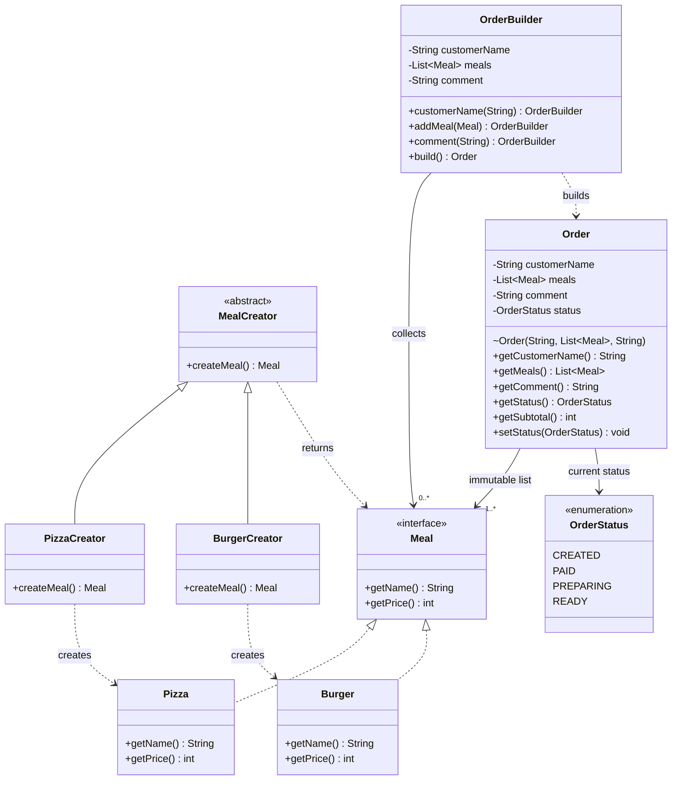
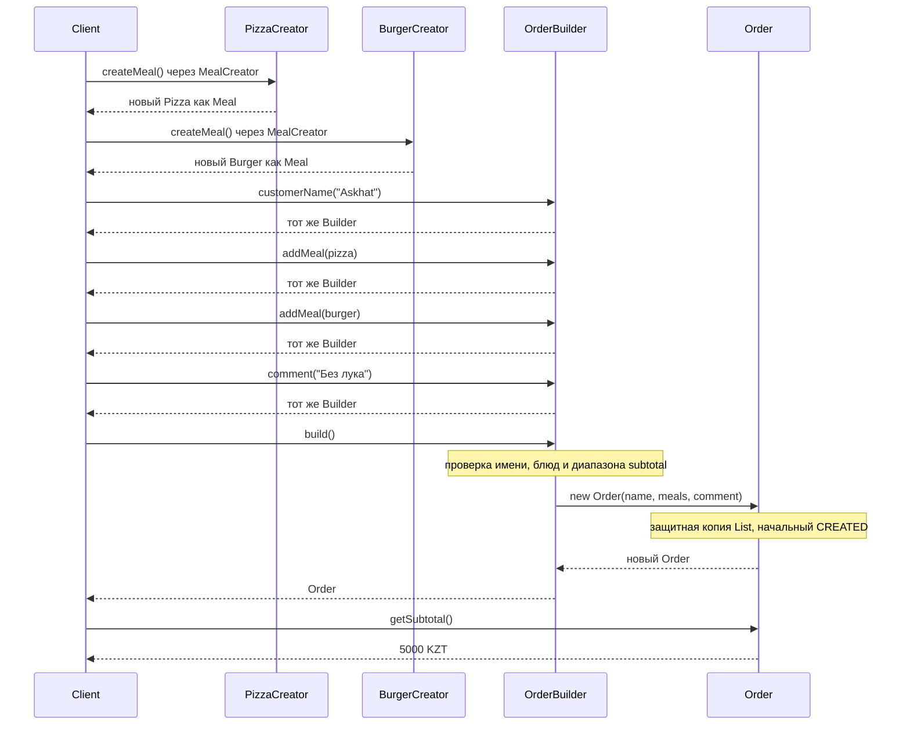

# Askhat — Factory Method и Builder

Диаграммы соответствуют реализованной основе проекта: девять Java-файлов в packages `meal`, `factory` и `order`. Observer-часть `Order` добавляет Danila; Facade и консольный клиент — Egor.

## Class Diagram

`~` обозначает package-private конструктор `Order`. Builder и Product находятся в одном package. `getMeals()` возвращает неизменяемую копию списка, созданную при построении заказа. Каждый Product блюда имеет постоянное имя и цену.

## Sequence Diagram: создание заказа

`Client` — роль вызывающего кода. На текущем этапе это ручной вызов в JShell; после интеграции выбор creators выполняет Main, а последовательность Builder — OrderFacade. Отдельный класс `Client` не требуется.

## Передача другим участникам

| Участник | Следующий шаг |
|---|---|
| Danila | Добавить `OrderObserver`, коллекцию подписчиков, регистрацию / отписку и закрытый `notifyObservers()`; вызвать уведомления после `status = newStatus`, сохранив валидацию и no-op |
| Egor | Создавать блюда через `MealCreator`; передавать их в Facade; собирать заказ через API Builder и менять статус только после успешного платежа |

Factory Method здесь использует наследование Creator и полиморфное создание Product. Builder отделяет накопление параметров и валидацию от готового заказа. Проверка допустимых переходов находится в `Order`; факт успешной оплаты впоследствии проверяет Facade.
