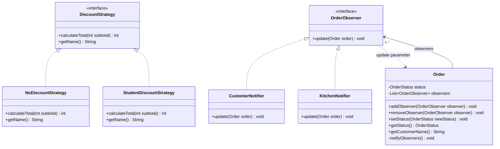
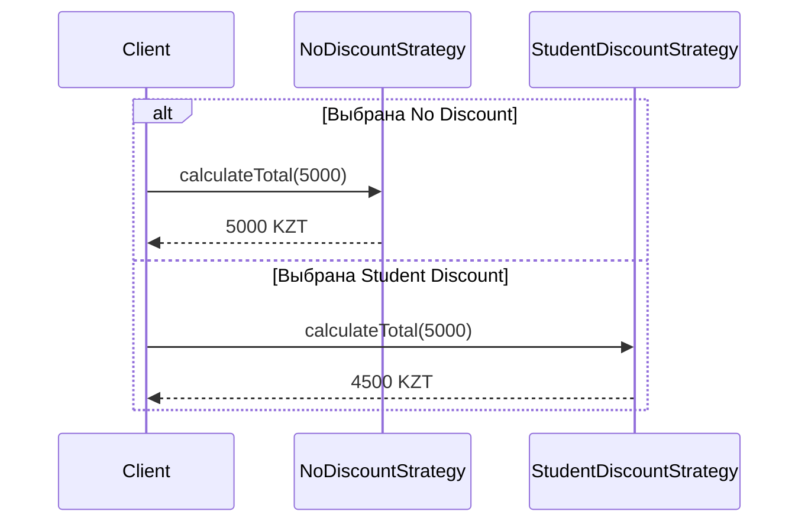
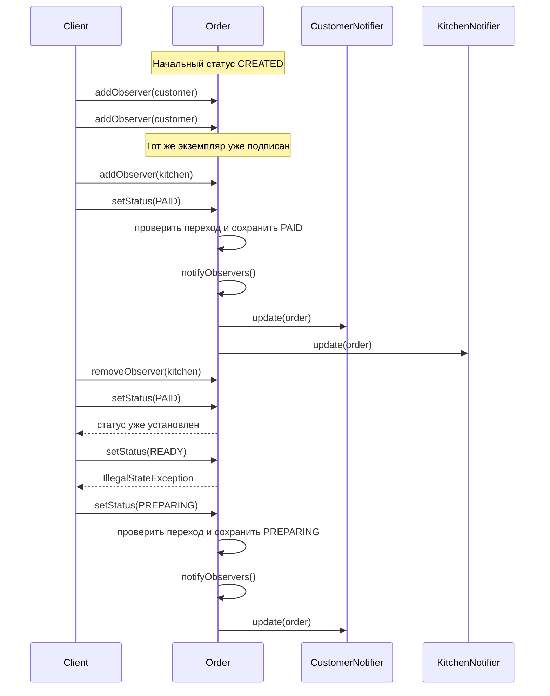

# Danila — Strategy и Observer

Диаграммы показывают две стратегии расчета суммы и механизм уведомлений в `Order`. В ручных примерах вызывающий код выполняет роль клиента. В общем приложении `Main` будет выбирать стратегию, а `OrderFacade` будет использовать ее как Context, то есть передавать ей сумму заказа для расчета.

## Class Diagram

## Sequence Diagram — расчет суммы

Обе реализации предоставляют один метод расчета. Для `0` обе возвращают `0`, для отрицательной суммы бросают `IllegalArgumentException`. Студенческая стратегия оставляет 90% суммы и округляет результат вниз до целого KZT. Промежуточное умножение выполняется в `long`, чтобы поддержать даже `Integer.MAX_VALUE`. Расчет читает только переданную сумму и сохраняет исходные цены блюд.

## Sequence Diagram — подписка, смена статуса и отписка

`Order` хранит подписчиков по интерфейсу `OrderObserver` и вызывает их в порядке подписки после сохранения нового статуса. Каждый подписчик читает имя и статус заказа и выводит свое сообщение. События возникают при переходах `CREATED → PAID → PREPARING → READY`. При подписке, отписке, повторе статуса и недопустимом переходе список полученных сообщений остается прежним.
