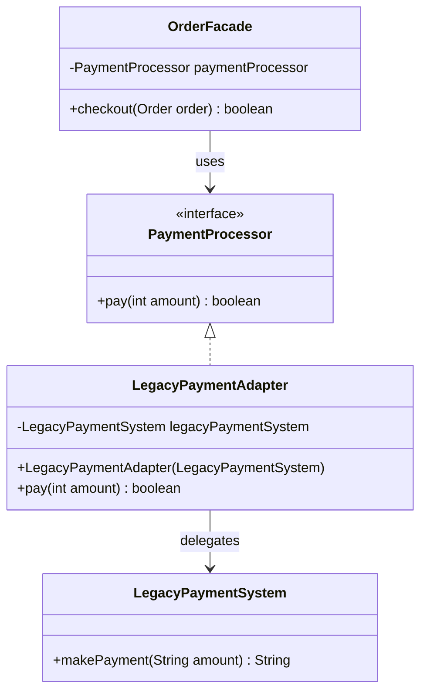
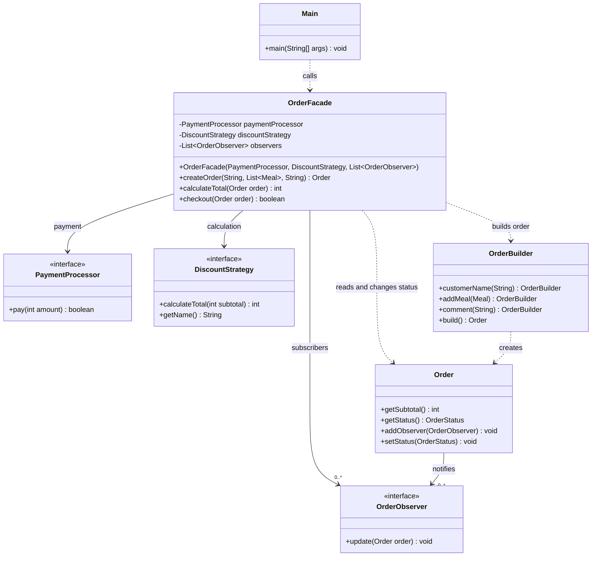
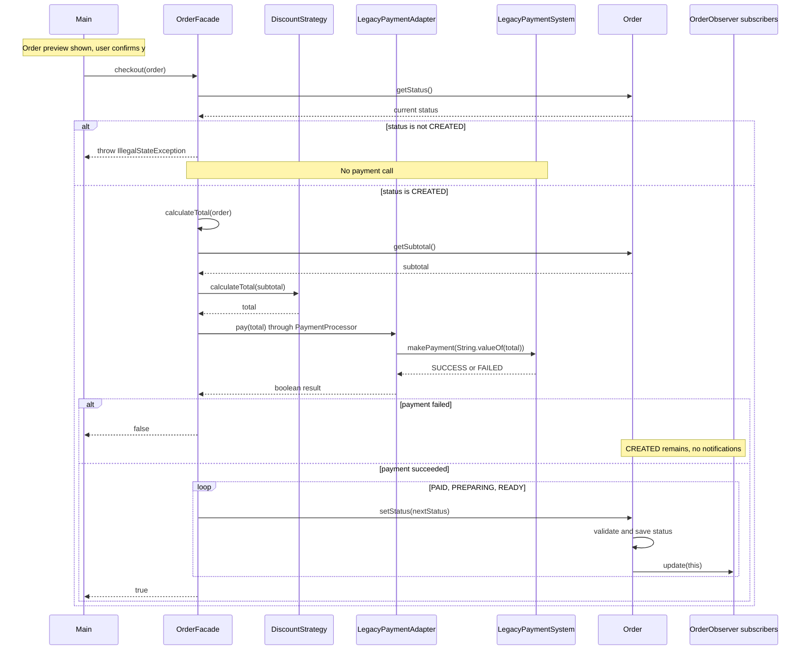

# Egor — Adapter и Facade

Диаграммы соответствуют классам `adapter.PaymentProcessor`, `adapter.LegacyPaymentSystem`, `adapter.LegacyPaymentAdapter`, `facade.OrderFacade` и `Main`. Классы заказа, скидок и уведомлений показаны как зависимости. Их реализации принадлежат Askhat и Danila.

Готовые изображения для отчёта и презентации:

| Диаграмма | PNG | SVG |
|---|---|---|
| Adapter | [Открыть PNG](egor-adapter-class.png) | [Открыть SVG](egor-adapter-class.svg) |
| Facade | [Открыть PNG](egor-facade-class.png) | [Открыть SVG](egor-facade-class.svg) |
| Checkout | [Открыть PNG](egor-checkout-sequence.png) | [Открыть SVG](egor-checkout-sequence.svg) |

Исходники Mermaid приведены ниже. SVG можно масштабировать без потери качества.

## Adapter: Class Diagram

| Роль Adapter | Класс | Назначение |
|---|---|---|
| Target | `PaymentProcessor` | Удобный для приложения контракт `pay(int): boolean` |
| Adaptee | `LegacyPaymentSystem` | Несовместимый строковый контракт `makePayment(String): String` |
| Adapter | `LegacyPaymentAdapter` | Преобразует аргумент и результат, вызывает Adaptee |
| Client | `OrderFacade` | Использует Target и не разбирает ответы Legacy |

Пример преобразования: `4500` → `"4500"` → `"SUCCESS"` → `true`. Adapter передает в Legacy и неположительные суммы; Legacy возвращает `"FAILED"`, а Adapter — `false`. Это локальная имитация оплаты без сети и настоящих списаний.

Ссылка на Legacy передается через конструктор и хранится в `final`-поле. Стрелка показывает связь объектов, а не наследование от старой системы. Реализация интерфейса обозначена пунктирной стрелкой с пустым треугольником.

## Facade: Class Diagram

На диаграмме показаны методы зависимостей, которые важны для Facade; это фрагмент, а не полный список членов всех классов проекта.

- `createOrder()` использует Builder и подписывает переданные observers. Этот метод не вызывает оплату.
- `calculateTotal()` передает subtotal в Strategy и не меняет заказ.
- `checkout()` проверяет начальный статус, рассчитывает total и вызывает PaymentProcessor. После успеха переводит заказ в `PAID`, `PREPARING`, `READY`.
- `Main` создает конкретные зависимости, ведет диалог и вызывает `checkout()` только после подтверждения `y`.

Facade не хранит формулу скидки и не вызывает `OrderObserver.update()` напрямую. Уведомления отправляет сам `Order` после изменения статуса.

## Checkout: Sequence Diagram

Отказ при корректном заказе проверяется через подстановку `PaymentProcessor`, возвращающего `false`. Штатная Legacy-имитация принимает положительные суммы, поэтому такой отказ проверяется через API Facade, а не отдельным пунктом меню.

После отказа заказ остается `CREATED`, и вызов можно повторить. Для уже оплаченного заказа повторный `checkout()` запрещен до нового обращения к платежной системе.
